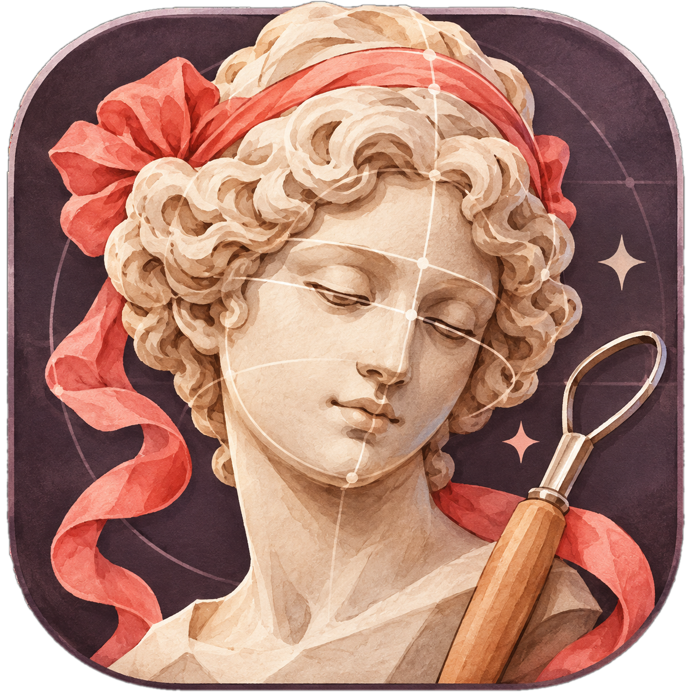

# MUSA · Tu guía para esculpir mejor

*(Antes se llamaba ESCULTOR.)*

App para escultores que, con la cámara del teléfono, **guía proporciones, anatomía y vistas** mientras modelas. Compara tu pieza con el canon clásico (o con tu propia referencia) y te dice **qué corregir y cuántos centímetros**.

**Abrir la app:** https://nayraoviedo.github.io/app-escultura/

**App para Android (APK):** https://github.com/nayraoviedo/app-escultura/releases/tag/apk → descarga `MUSA.apk` desde el teléfono e instálalo.

Funciona en Chrome de Android y en computadora. **No necesita servidor**: todo se procesa en tu dispositivo. Se puede **instalar como app** y usar **sin internet**.

---

## Pantalla
Al abrir MUSA ves sobre todo **la cámara**, la zona elegida arriba (Cuerpo, Torso, Rostro, Mano y brazo…) y un botón para desplegar herramientas.
- **Barra de acciones** (flotante, sobre la imagen): Foto · Congelar · **Herramientas** (botón redondo central) · Referencia · Voz. La **navegación** de abajo (Inicio, Progreso, Referencias, Favoritos, Estadísticas) es una barra sólida aparte.
- **Herramientas inteligentes según el modo:** el panel muestra solo **6** herramientas, las que sirven para la zona elegida, y un botón **«Ver todas las herramientas»**:
  - Cuerpo: Medir, Maniquí, Plomada, Anatomía, Calcar, Simetría
  - Torso: Medir, Puntos, Simetría, Anatomía, Ropa, Calcar
  - Rostro: Medir, Calcar, Facciones, Simetría, Orejas, Cabello
  - Mano y brazo: Medir, Calcar, Compás, Regla, Anatomía, Espejo
  - Piernas: Medir, Plomada, Compás, Anatomía, Armazón, Calcar
  - Animales: Especie, Medir, Calcar, Plomada, Compás, Simetría
  - Relieve: Tipo de relieve, Profundidad, Medir, Calcar, Plomada, Anatomía
- Las **opciones** (tipo de ropa, expresión, especie, tipo de relieve) aparecen solo al tocar esa herramienta.
- El botón central abre y cierra el panel sin cambiar de pantalla; cerrado, la cámara queda casi a pantalla completa. El botón ⛶ deja **solo la cámara**.
- **Correcciones (n):** una ficha pequeña a la derecha; al tocarla se desliza una **bandeja** con el detalle. Se cierra tocando fuera o el título.
- **Doodles en lugar de emojis** y cifras de medida solo con **Medir** activo.
- **Letra manuscrita:** el nombre en *Caveat* y los títulos y botones en *Kalam* (van dentro de la app, licencia SIL OFL, carpeta `fonts/`). Las correcciones siguen en letra clara para leerlas bien. En ⚙️ ▸ *Letra*: manuscrita en títulos y botones, manuscrita en todo, o clara.
- **Ícono:** busto clásico con cinta roja, guías de proporción y desbastador, en acuarela (`docs/icono-musa.png`).

## Cómo empezar
1. Abre la app en Chrome y permite la cámara.
2. Responde **«¿Qué vas a esculpir?»** (busto, figura completa, relieve, animal, criatura, estudio de manos o pies): la app muestra solo los modos y herramientas que sirven para ese trabajo. Lo cambias tocando el subtítulo junto al logo. Un **recorrido de 5 pasos** te muestra dónde está cada cosa.
3. Elige el **modo** arriba (Cuerpo, Torso, Rostro, Manos, Piernas y pies, Animales, Relieve). Debajo de la imagen tienes los **accesos rápidos** del modo (expresión, ropa, anatomía, armazón, cabello, simetría…).
4. Pulsa **📷 Foto** o abre la cámara (*Más ▸ Cámara*). Mejor con el teléfono quieto (trípode), vertical y a media altura de la pieza.
5. En **⚙️** indica la figura: edad, sexo, complexión, **altura final en cm** y el **material** (la app agranda las medidas según cuánto encoge: terracota ~10%, gres ~12%, porcelana ~15%, bronce ~2%…).
6. **🎯 Solo cámara** (primer botón de abajo, o el botón ⛶ sobre la imagen): pantalla limpia con la cámara a pantalla completa y **una corrección grande** abajo (◀ ▶, 🔊 Leer, ✓ Hecho; ▾ la oculta). Arriba: Salir, Congelar, Voz y 📸 Guardar. Se sale con «atrás». En *Más* puedes hacer que la cámara se abra siempre así.
7. Sigue el panel **Correcciones pendientes**: *Ver en cámara* te señala la parte; cuando la arregles, *Marcar como corregido*.

**Instalarla y usarla sin internet:** *Más ▸ 📲 Instalar MUSA como app* y luego *Más ▸ 📥 Descargar todo para usar sin internet*.

---

## Modos
| Modo | Qué revisa |
|---|---|
| **Cuerpo** | Maniquí con el canon en la misma pose de tu pieza (con escorzo). Largo de cada parte en cm, hombros y caderas, contrapposto, **largo completo** de brazos, tronco y piernas, **grosores de brazos, tronco y piernas** y **morfología**: si los grosores corresponden a la complexión elegida (delgada, media, robusta), qué zona está desequilibrada y si la relación hombros/caderas se lee como hombre o mujer |
| **Torso** | Clavículas, pezones, pecho, cintura, ombligo y caderas, distintos en hombre y mujer. De perfil, alturas; de frente, simetría de los pechos. Ajusta las guías al giro y la inclinación del tronco. Puede poner sola una **referencia parecida** encima, alineada. **Tronco completo** (de la barbilla a las caderas) y lectura hombre/mujer |
| **Rostro** | Eje central, tercios, **distancia entre ojos**, simetría y tamaño de los ojos, nariz, boca, inclinación de la cabeza y **orejas** (entre cejas y base de la nariz) |
| **Mano y brazo** | Mano: largo de cada dedo frente al medio, dedo medio frente a palma, **ancho de la palma** y flexión. Brazo: **largo completo del hombro a la punta de los dedos** (y cuánto mide cada tramo), dónde debería terminar la muñeca, prueba del brazo caído (la muñeca llega a la entrepierna) y **grosor** de bíceps, codo, antebrazo y muñeca. Para el brazo, que se vean hombro y cadera |
| **Piernas y pies** | **Pierna completa** (cadera → tobillo), largos, simetría, eje cadera–rodilla–tobillo, **grosor** de muslo, rodilla, pantorrilla y tobillo, y largo del pie |
| **Animales e híbridos** | Plantillas de puntos y canon por especie (ver abajo) |
| **Relieve** | Bajo, medio, alto o aplastado (schiacciato): profundidad total sugerida y **mapa de alturas** (cuántos cm sobresale cada parte), en tres planos |

Las vistas **Frente / Lado der. / Lado izq. / Espalda** guardan cada una su imagen. Con frente y lado, la app combina ambas y calcula **medidas 3D reales**.

### Todo varía según la figura
Los largos completos (brazo, tronco, pierna), los grosores, la prueba del brazo caído y la morfología cambian con lo elegido en ⚙️: **edad** (bebé, niño/a, adolescente, adulto), **sexo** y **complexión** (delgada, media, robusta). En niños y bebés no se busca diferencia hombre/mujer (antes de la adolescencia casi no existe). En **Animales**, los grosores cambian con la complexión, con **cría** (edad bebé o niño) y con macho/hembra en el cuello de toro, león o caballo. En los **híbridos**, la parte humana se mide con el detector de personas y el canon humano, con lo propio de cada criatura: minotauro robusto y sin cuello humano, ukuku y chachapuma con brazos largos, ekeko bajo y de brazos cortos, sirena sin piernas, arpía sin brazos (son alas), centauro solo brazos y hombros…

### Animales e híbridos
- **Animales:** caballo, perro, gato, toro, león, llama, puma, cóndor andino.
- **Bolivia y los Andes:** Chachapuma (Tiwanaku), Hombre cóndor, Ukuku, Amaru, Diablo/Supay de la Diablada de Oruro, Ekeko, Yaguareté-abá, Anchanchu, Tío de la mina, Pachamama, Jichi, Achachila.
- **Clásicos:** centauro, sirena/tritón, minotauro, sátiro, arpía, esfinge, pegaso, grifo.

Cada criatura trae una nota cultural, consejos para la **unión** entre sus partes y proporciones medidas en "cabezas" del propio animal. En los cuadrúpedos también se mide el **grosor** del antebrazo, las cañas, la pierna trasera y el cuello. *Las proporciones de las criaturas mitológicas son orientativas: no existe un canon oficial. Para un estilo concreto, usa tus propias referencias.*

---

## Herramientas (botón **Más ▾**, ordenado por secciones y con buscador)
- **Medir:** cm de cada parte y ángulos de codos y rodillas sobre la imagen.
- **🧭 Medir con compás:** escribe lo que mides en el barro y la app te dice cuánto corregir. Es lo más fiable: no depende de la cámara.
- **📏 Regla:** mide con dos toques.
- **Bordes ajustables:** arrastra los extremos de cada grosor si el borde no quedó bien. **🎨 Tocar el barro** le enseña a la app el color de tu pieza.
- **Espejo, Plomada** (vertical real, contrapposto y equilibrio), **Contraste**.
- **⟷ Espejo de simetría:** refleja una mitad sobre la otra y marca en rojo lo que no coincide.
- **Calcar:** imagen de referencia sobre la cámara (opacidad, mover, girar, **🎯 Alinear** a hombros y caderas). **◑ Comparar silueta:** en rojo lo que sobra y en azul lo que falta.
- **💇 Cabello según la pose:** lee la energía de la pose (inclinación, contrapposto, brazos, piernas, hacia dónde mira) y sugiere un peinado en armonía —recogido, cayendo con la gravedad o al viento— y dibuja su dirección y el volumen máximo recomendado.
- **🙂 Expresiones del rostro** (alegría, tristeza, enojo, sorpresa): qué músculos cambian, qué expresión parece tener tu pieza y flechas de qué mover (cejas, párpados, comisuras, boca).
- **🧵 Pliegues de ropa** (pollera, poncho, aguayo, túnica, manto): dibuja los pliegues sobre la pose según los puntos de apoyo y explica qué tipo usar (columna, zigzag, medio nudo, espiral, caída en U, tensión, reposo).
- **🦴 Plano del armazón:** largos en cm de cada tramo de alambre, dibujo, calibre sugerido y alambre total; también **sobre la cámara**, en la pose de tu figura.
- **🖨️ Hoja de medidas:** todas las medidas del canon (con la contracción incluida) y el armazón, para imprimir o guardar en PDF.
- **🦴 Anatomía:** esqueleto y músculos sobre la pose; toca uno para saber qué es y cómo modelarlo.
- **🔄 Vuelta completa:** 8 vistas en la torneta y comparación de siluetas opuestas.
- **📐 Ampliar desde maqueta:** factor y conversor de medidas.
- **🎙️ Manos libres:** comandos de voz ("congelar", "siguiente", "corregido", "repite", "modo rostro", "ayuda"…). Necesita Chrome con internet.
- **Vista grande** y **colores de alto contraste**.
- **📸 Guardar progreso** y **Estadísticas** por proyecto.
- **💾 Copia de seguridad / 📂 Restaurar:** todo en un archivo, para guardarlo en Google Drive.

## Biblioteca de referencias
**🛡️ Búsqueda segura** (activada por defecto, se cambia en ⚙️ *Ajustes de la app*): oculta fotos explícitas y deja solo obras de arte y láminas (esculturas, estatuas, dibujos, anatomía).

- Busca en **Wikimedia Commons**, **Openverse** y modelos 3D de **Sketchfab**, en español o en **chino** (la app traduce los términos).
- Cada imagen guarda **autor, licencia y origen**. Respeta la licencia y cita al autor si publicas una obra basada en ella.
- **Mis referencias:** sube fotos o **PDF** (libros de anatomía, láminas), organiza por colecciones y proyectos; funcionan sin conexión.
- **Analizar** (cuerpo, rostro, manos), **comparar** hasta 4 referencias y usarlas sobre la cámara o como **proporciones del maniquí**.
- **Referencias parecidas:** la app revisa tus imágenes y cada página de tus PDF y te sugiere las más parecidas a la pose, el rostro o la mano que ve la cámara.

---

Los **grosores** (brazos, piernas, tronco, patas) tienen valores de referencia para adultos (hombre y mujer, por complexión), **niños y bebés** (orientativos: varían mucho con la grasa) y cada animal.

## Límites a saber
- Los detectores se entrenaron con **personas**: con barro sin terminar o piezas muy estilizadas pueden fallar. Usa puntos manuales (✋), bordes ajustables o el compás.
- Con escorzo fuerte, la app marca las partes en **gris** en vez de inventar una medida. La vista combinada frente + lado lo resuelve mejor.
- El rostro se mide desde la frente detectada (no desde lo alto del cráneo): los milímetros del rostro son aproximados.
- Animales y criaturas se marcan a mano: ningún detector los reconoce en una escultura.

## Android / APK
Hay una **app Flutter** (`flutter_app/`) que lleva dentro toda la app web y funciona **sin internet**. GitHub la compila sola en cada cambio y deja el APK en *Releases* ([descargar](https://github.com/nayraoviedo/app-escultura/releases/tag/apk)). Dentro de la app:
- cámara y micrófono con los permisos de Android;
- **voz** con el lector de Android y **manos libres** con el reconocimiento de voz del teléfono;
- **imprimir / guardar como PDF** la hoja del taller;
- **copias y ejemplos** se guardan o comparten con el menú de Android (Drive, WhatsApp…);
- la pantalla no se apaga mientras esculpes.

Más detalles y otras formas de instalar: [`docs/ANDROID.md`](docs/ANDROID.md).

## Entrenar un detector propio
Ver [`entrenamiento/LEEME.md`](entrenamiento/LEEME.md): guarda ejemplos corregidos desde la app (*Más ▸ 🧠 Guardar ejemplo*), expórtalos y entrena gratis en Google Colab con `entrenamiento/entrenar_escultor.ipynb`.

---

## Estructura del proyecto
| Archivo | Contenido |
|---|---|
| `index.html` | Interfaz |
| `app.js` | Cámara, detección de pose, maniquí, plomada, calco, vistas |
| `canon.js` | Cánones (bebé, niño, adolescente, adulto 7½ y 8; hombre y mujer) |
| `modos.js` | Modos de trabajo, correcciones, consejo, progreso, estadísticas, compás |
| `lib.js` | Biblioteca, PDF, análisis de referencias, referencias parecidas |
| `extra.js` | Voz, uso sin conexión, simetría, copias, vista grande, maqueta, torneta, comparar silueta, 3D |
| `anatomia.js` | Capas de esqueleto y músculos |
| `animales.js` | Animales, criaturas andinas e híbridos |
| `proporciones.js` | Brazo, tronco y pierna completos; grosores en Cuerpo; morfología |
| `interfaz.js` | Distribución: estado sobre la imagen, barra inferior y panel de Herramientas |
| `letra.js`, `fonts/` | Letra manuscrita (Caveat y Kalam) y su ajuste |
| `doodle.js` | Íconos dibujados (doodles) en lugar de emojis |
| `limpio.js` | «Solo cámara»: pantalla limpia con una corrección grande |
| `nativo.js` | Puente con la app Android (voz, micrófono, archivos, imprimir); en el navegador no hace nada |
| `flutter_app/` | App Flutter para Android (`lib/main.dart`, `tool/preparar_android.py`) |
| `.github/workflows/apk.yml` | Compila el APK en GitHub y lo publica |
| `sw.js`, `manifest.webmanifest` | App instalable y sin conexión |
| `mp/` | Detectores MediaPipe (pose, rostro, manos) |
| `pdf/` | pdf.js |

**Tus fotos:** las fotos de progreso se guardan dentro de la app, en tu teléfono. Para llevarlas a **Google Drive** o a tu galería: *Progreso ▸ 💾 Guardar / compartir* en cada foto, o *Más ▸ Copia de seguridad* para todo junto.

**Privacidad:** fotos, referencias y medidas se guardan solo en tu dispositivo. Solo salen a internet las búsquedas de la Biblioteca y el reconocimiento de voz de Chrome.

**Créditos:** MediaPipe (Google, licencia Apache 2.0) y pdf.js (Mozilla, licencia Apache 2.0). Las imágenes de la Biblioteca pertenecen a sus autores, con las licencias indicadas en cada una.
